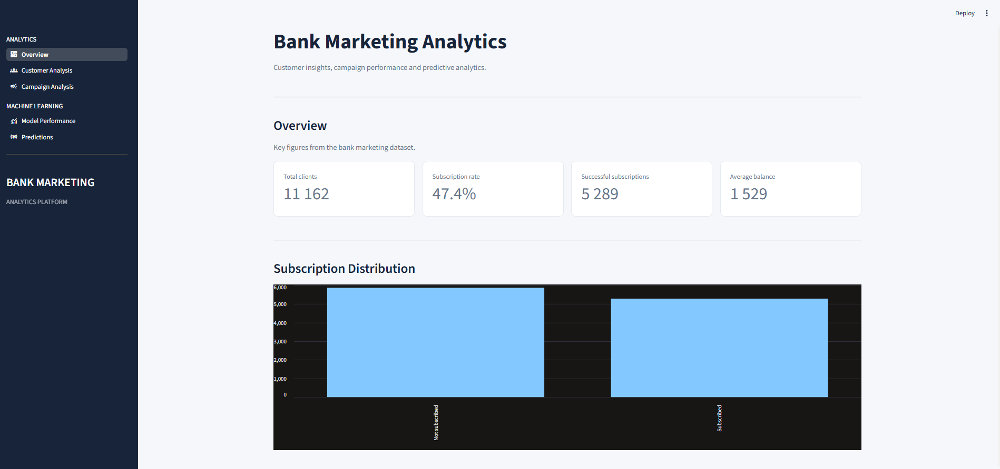
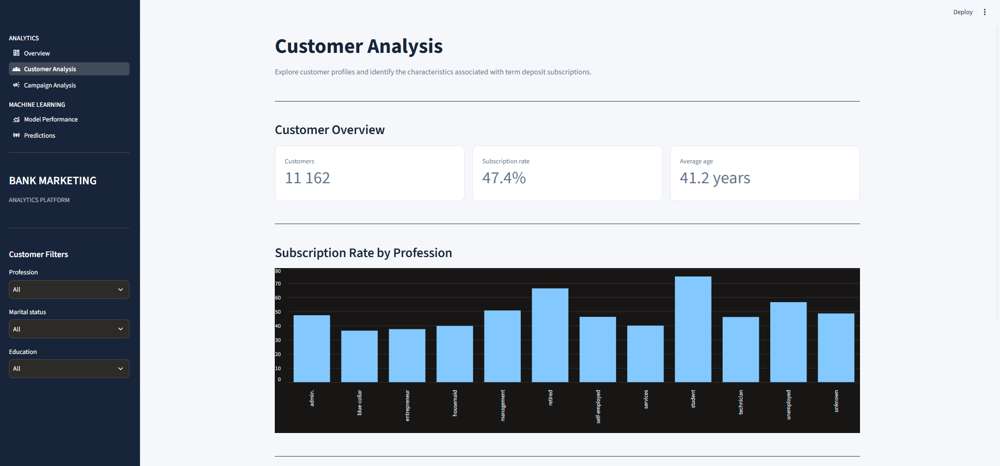
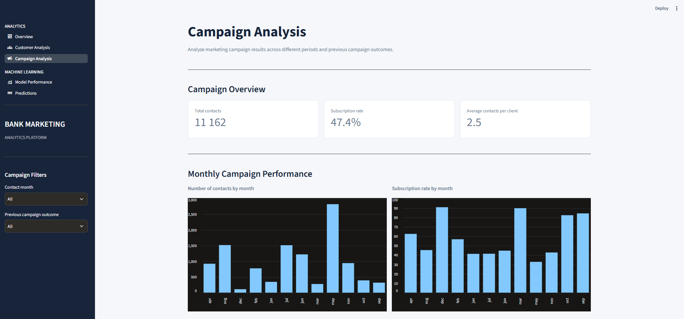
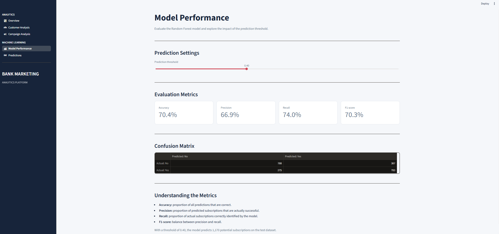
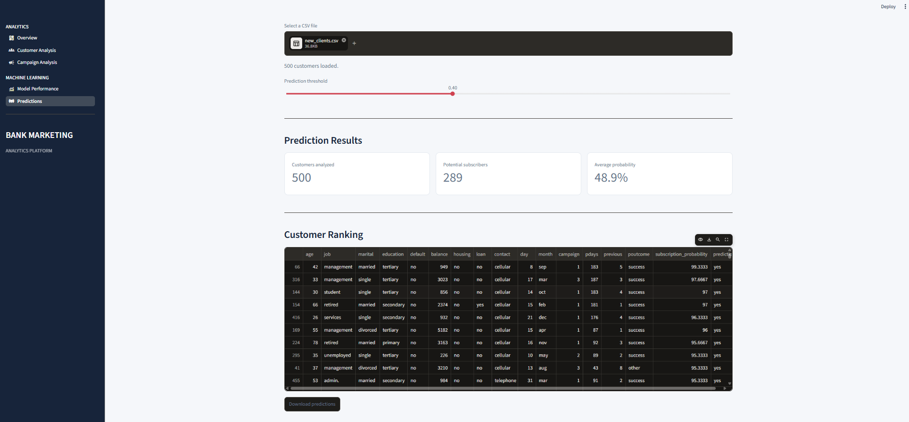

# Bank Marketing Subscription Prediction

**An End-to-End Data Science Project | Python · SQL · Machine Learning · Streamlit**

Predicting which bank customers are most likely to subscribe to a term deposit — and translating predictive insights into actionable marketing decisions.

---

## Project Overview

Bank marketing campaigns often involve contacting large numbers of customers, even though only a proportion of them will subscribe to the offered product.

The objective of this project is to develop a machine learning solution that helps identify customers with a higher likelihood of subscribing to a term deposit.

Rather than focusing exclusively on model performance, this project follows an end-to-end analytical approach: from data exploration and SQL-based business analysis to predictive modelling, evaluation and an interactive decision-support dashboard.

**The central business question:**

*How can a bank use customer and campaign data to prioritize its marketing efforts and improve the efficiency of its term deposit campaigns?*

## Key Results

The selected Random Forest model was evaluated on a stratified hold-out test set, using a classification threshold of 0.40.

| Metric | Result |
|---|---:|
| Accuracy | **70.4%** |
| Precision | **66.9%** |
| Recall | **74.0%** |
| F1-score | **70.3%** |

### What do these results mean from a business perspective?

- **74.0% Recall:** The model identifies approximately 74% of customers who actually subscribe. This is relevant when the objective is to avoid missing potential subscribers.
- **66.9% Precision:** Approximately 67% of customers predicted as likely subscribers actually subscribe. This helps limit unnecessary marketing efforts.
- **70.3% F1-score:** The model achieves a balance between identifying potential subscribers and maintaining prediction reliability.

The classification threshold was set to 0.40 rather than relying automatically on the default 0.50 threshold. This illustrates an important business consideration: the optimal decision threshold depends on the relative cost of missed opportunities and unnecessary customer contacts.

## Analytical Approach

The project was structured into several complementary stages.

### 1. Data Understanding & Exploration

The initial analysis focused on understanding the dataset, its structure and the meaning of its variables.

Key steps included:
- Inspecting the dataset structure and data types.
- Analysing the target variable distribution.
- Identifying missing values and unusual observations.
- Studying numerical distributions and categorical variables.
- Exploring relationships between customer characteristics, campaign information and subscription outcomes.

The objective was not simply to describe the data, but to identify patterns that could inform both feature selection and business interpretation.

### 2. SQL Business Analysis

SQL was used to complement Python-based exploration with a business-oriented perspective.

The analysis focused on customer segmentation, subscription patterns and campaign-related indicators.

This stage helped connect the dataset to practical marketing questions and demonstrated how SQL can be used to extract meaningful insights from structured business data.

### 3. Exploratory Data Analysis

A deeper exploratory analysis was conducted to investigate the factors associated with subscription behaviour.

Among the patterns observed:

- **Customer profile:** subscription rates varied considerably across professional categories and age groups.
- **Campaign timing:** subscription rates differed substantially between months, suggesting that campaign timing deserves attention.
- **Previous campaign outcomes:** customers with a previous successful campaign outcome displayed a particularly high subscription rate.
- **Existing financial commitments:** customers with housing loans or personal loans showed lower observed subscription rates than customers without these loans.

These observations are descriptive associations, not proof of causality. They were used to guide the modelling process and formulate business hypotheses.

### 4. Data Preparation & Feature Engineering

Data preparation focused on producing a consistent dataset while preserving meaningful information.

Important decisions included:

- Handling categorical and numerical variables appropriately.
- Preserving informative `unknown` categories instead of automatically treating them as missing values.
- Keeping `pdays = -1` as a meaningful indicator of no previous contact, rather than treating it as an ordinary numerical value without context.
- Reviewing potential outliers without automatically removing observations.
- Excluding variables that would not be available at the intended prediction time.

**Preventing data leakage**

One particularly important decision was to exclude the `duration` variable.

This variable represents the duration of the phone call. Since it is only known once the call has taken place, using it to predict subscription before contacting the customer would introduce information unavailable at decision time.

Excluding it makes the modelling objective more realistic and aligns the prediction task with a genuine pre-contact marketing use case.

### 5. Machine Learning Modelling

A Random Forest classifier was selected for the prediction task.

The model was trained to estimate the probability that a customer would subscribe to a term deposit.

The modelling workflow included:
- Defining the prediction target.
- Separating features from the target variable.
- Splitting the data into training and test sets.
- Using stratification to preserve the target distribution.
- Training the Random Forest model.
- Evaluating predictions with several complementary classification metrics.
- Adjusting the classification threshold to reflect the business objective.

The final evaluation used a stratified 80/20 train-test split with a fixed random state of 42.

### 6. Interactive Streamlit Dashboard

The project includes an interactive dashboard designed to make the analysis accessible beyond a notebook environment.

It contains five main sections:

- **Overview:** high-level business indicators and subscription distribution.
- **Customer Analysis:** customer segmentation and subscription patterns.
- **Campaign Analysis:** campaign activity and historical outcomes.
- **Model Performance:** evaluation metrics and confusion matrix, with an adjustable classification threshold.
- **Predictions:** upload customer data, generate subscription probabilities, rank customers and export predictions.

The dashboard bridges the gap between analytical modelling and practical business use.

## Technology Stack

| Area | Technologies |
|---|---|
| Programming | Python |
| Data manipulation | Pandas, NumPy |
| Data analysis | Jupyter Notebook |
| Database analysis | SQL, SQL Server |
| Machine Learning | Scikit-learn, Random Forest |
| Model persistence | Joblib |
| Dashboard | Streamlit |
| Version control | Git, GitHub |

## Project Structure

```text
bank-marketing-prediction/
│
├── app.py
├── pages/
│   ├── overview.py
│   ├── customer_analysis.py
│   ├── campaign_analysis.py
│   ├── model_performance.py
│   └── predictions.py
│
├── data/
│   ├── bank_marketing.csv
│   ├── new_clients.csv
│   └── targeted_clients.csv
│
├── models/
│   └── random_forest.pkl
│
├── notebooks/
│   ├── 01_data_exploration.ipynb
│   ├── 03_exploratory_data_analysis.ipynb
│   ├── 04_data_preprocessing.ipynb
│   └── 05_model_training.ipynb
│
├── requirements.txt
└── .gitignore
```


### Dashboard Preview

The application provides an interactive interface combining business analytics, customer segmentation and machine learning predictions.

#### Overview


#### Customer Analysis
Explore customer profiles and identify subscription patterns across different segments.



#### Campaign Analysis
Analyze campaign activity, monthly performance and previous campaign outcomes.



#### Model Performance
Evaluate the Random Forest classifier through classification metrics, a confusion matrix and an adjustable prediction threshold.



#### Customer Predictions
Upload customer data, estimate subscription probabilities, rank potential subscribers and export prediction results.




## Run the Project Locally

### 1. Clone the repository

```bash
git clone https://github.com/paulhbrt/bank-marketing-prediction.git
cd bank-marketing-prediction
```

### 2. Create and activate a virtual environment

```bash
python -m venv .venv
```

On Windows:

```bash
.venv\Scripts\Activate.ps1
```

### 3. Install dependencies

```bash
pip install -r requirements.txt
```

### 4. Launch the dashboard

```bash
streamlit run app.py
```

The dashboard will open in your browser.

## Business Perspective & Limitations

A predictive model can help prioritize customers, but its output should support human decision-making rather than replace it.

Several considerations are important before using such a model in a real marketing environment:

- **Prediction is not causation:** a high predicted subscription probability does not prove that contacting a customer will cause them to subscribe.
- **Campaign costs matter:** the appropriate classification threshold depends on contact costs, campaign capacity and the value of a successful subscription.
- **Historical patterns may change:** customer behaviour and campaign effectiveness can evolve over time.
- **Temporal validation would be valuable:** a future version should evaluate the model on a later campaign period to better assess its ability to generalize to new market conditions.
- **Data availability matters:** the model assumes that its input features are available before the marketing contact takes place.

These limitations are part of the analytical process. Understanding when a model can be trusted is just as important as knowing how to train one.

## Future Improvements

Potential next steps include:

- Comparing Random Forest with Logistic Regression and other classification algorithms.
- Evaluating ROC-AUC and Precision-Recall curves.
- Conducting systematic threshold optimization based on business costs.
- Adding explainability techniques to better understand individual predictions and feature contributions.
- Implementing temporal validation to assess performance on future campaigns.
- Exploring campaign prioritization strategies based on expected business value.

## Final Takeaway

This project demonstrates an end-to-end Data Science workflow, combining technical implementation with business-oriented reasoning.

It highlights the importance of understanding data before modelling, making informed feature-selection decisions, evaluating predictions beyond accuracy, and translating analytical results into actionable insights.

**The goal is not simply to predict customer behaviour, but to understand how predictive analytics can support better business decisions.**